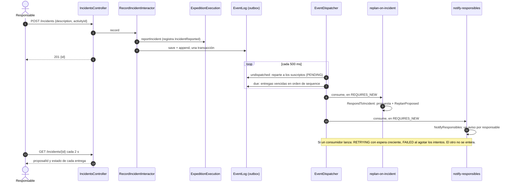

# Decisiones de diseño

## Aplicadas

**Arquitectura.** Clean Architecture en cinco módulos Maven, con dependencias solo hacia adentro: `application`, `adapters` y `api` dependen solo de `domain`, y `frameworks` de los cuatro. Como las interfaces de caso de uso y los puertos están en `domain`, ni un controlador ni un adaptador pueden nombrar un interactor: el build no lo compila. `domain` guarda el modelo, los servicios de dominio (`Replanner`, `IncidentResponder`, `AssignmentSuggester`, `RuleBasedValidator`, `ExpeditionTracker`, `ProposalReviewer`, `PlanningContexts`), los puertos de lectura (`People`, `Vehicles`, `Instruments`, `Consumables`, `Permits`, `Certifications`, `Catalogs`, `Plans`, `Runs`, `Proposals`), las interfaces de caso de uso, los snapshots, los repositorios de escritura, `Clock`, `Page` y los `*Registry` de escritura, que extienden el puerto de lectura. `application` guarda solo los interactors. `adapters` implementa esos puertos tres veces, en memoria (un `InMemory*Registry` por recurso y los repositorios `InMemory*`), con Spring Data JPA sobre PostgreSQL (`adapters.jpa`) y con Spring Data MongoDB (`adapters.mongo`), más el reloj (`SystemClock`), y no nombra interactors. `frameworks` es la raíz de composición (`FieldOpsApplication` y las `@Configuration` de Spring) y los tests que manejan el sistema. Dentro de `domain` los paquetes siguen el componente: `validation → expedition → {tracking, itinerary, catalog, assessment}`, `report → {expedition, tracking}`, `tracking → {identity, shared}`. Las transiciones del agregado y las operaciones de `Replanner` que los casos de uso invocan son públicas y conservan su precondición. Las que dependen de algo que un caso de uso podría elegir (la hora, el plan vigente, los predecesores, quién decide, el incidente) son del paquete y las llaman los servicios de dominio: `ExpeditionTracker`, `ProposalReviewer` e `IncidentResponder`, que llama a `Replanner.propose`. La política de aprobación la ejecuta `Expedition.approve`; `ApproveExpeditionInteractor` carga el plan y su predecesor y persiste. `ExpeditionExecution` sigue en `expedition` porque es el agregado de la corrida. Los ids salen de los repositorios. El tiempo sale de `Clock`.

**Validador como puerto.** `ExpeditionValidator` es una interfaz de `expedition` y `RuleBasedValidator`, en `validation`, la implementa. Tiene una sola implementación porque existe para cortar el ciclo entre esos paquetes (DIP).

**Casos de uso.** `AdministerPersonnel`, `AdministerEquipment`, `AdministerPermits`, `ConsultPersonnel`, `ConsultEquipment`, `ConsultPermits`, `DraftExpedition`, `PlanItinerary`, `AssignResources`, `ReviewExpedition`, `ApproveExpedition`, `TrackExpedition`, `RecordIncident`, `RespondToIncident`, `ReplanExpedition`, `ReviewReplanProposal`, `ConsultExpedition`, `EstimateExpedition`, `ReportExpedition`, `ConsultEvents`, `ManageEventDeliveries`, `NotifyResponsibles`, `ConsultNotifications`. Cada uno agrupa las operaciones de un actor; seguimiento e incidentes están separados porque cambian por motivos distintos, y también la consulta del catálogo de su administración: quien planifica lee el catálogo para asignar y no lo modifica. Los que modifican cargan por id, aplican y guardan; los de lectura no guardan. Ninguna entidad mutable sale: las consultas devuelven `PlanSnapshot`, `ProposalSnapshot`, `RunSnapshot`, `Estimate`, `OperationalReport`, `ValidationResult` y `Notification`, armados por el interactor; los recursos del catálogo salen como entidades porque son inmutables. Entran ids y objetos inmutables. Las colecciones se leen por página con `PageRequest` y `Page`, de `domain.shared`: los puertos que las devuelven viven en el dominio y no dependen hacia afuera.

**Puertos.** Lectura por recurso (`People`, `Vehicles`, `Instruments`, `Consumables`, `Permits`, `Certifications`), los reservables y de validación agrupados en `BookableResources` y `Catalogs`, en `domain`, porque las reglas y el sugeridor los usan. La escritura también es por recurso y vive en `domain`: cada `*Registry` extiende su puerto de lectura con el próximo id, `save` (upsert), el listado por página y un `require` que lanza `UnknownResource`, así la validación no depende de métodos de escritura y los interactors no repiten la búsqueda. `ExpeditionRepository` (los ids de actividad y `all(PageRequest)`) extiende `Plans` (`find`, `all` y `require`), y `ExecutionRepository` extiende `Runs` (`find`), igual que los `*Registry`. `ReplanProposalRepository` (con las propuestas de un plan por página), que extiende `Proposals`; `EventLog` (extiende `Events`), `EventDeliveries` (extiende `Deliveries`), `Notifier`/`Notifications`; y `Clock` también están en `domain`. Las entidades no guardan ni usan puertos de escritura; cuando una regla necesita datos de afuera, reciben el puerto de lectura o el servicio de dominio como argumento (`People` en `Expedition.draft`, `Catalogs` en `addAssignment`, `Permits` en `addPermit`, `PlanningContexts` en `submitForReview`, `approve` y `acceptWarning`), nunca una lista o un contexto que armó quien llama. Los servicios de dominio leen los puertos de lectura que necesitan: `ExpeditionTracker` recibe `Plans`, `Runs`, `Consumables` y `Clock`, `ProposalReviewer` recibe `Plans` y `Clock`, `PlanningContexts` recibe `Plans`, `Runs` y `Catalogs`, `Replanner` recibe `PlanningContexts` e `IncidentResponder` recibe `Plans`, `Proposals`, el `Replanner` y `Clock`, y ninguno guarda; guardar es del interactor. Los adaptadores en memoria, los de JPA y el reloj del sistema están en `adapters`.

**Clean Code.** Hasta tres argumentos por método. Excepciones: los records, que son datos con nombre (estados, snapshots, informes, requests y responses de la API, filas de los adaptadores); los constructores que reciben colaboradores o estado (interactors, `ExpeditionTracker`, `Person`, `ActivityStart`, `PlanContent`); `Replanner.propose`, del paquete (el id sale del repositorio y el incidente y la corrida son de otro agregado); los dos ids que pide `IncidentResponder.respondTo` viajan juntos en `ReplanIds`; los métodos que Spring define en `ApiExceptionHandler`; y el constructor de `DemoData`, que recibe los casos de uso que carga. `ExpeditionCharter` y `PlanningContext` agrupan argumentos que viajan juntos; `Activity` se arma con un builder por tipo. Sin banderas booleanas: `ActivityBlock.Arrangement` en vez de `boolean parallel`, `overlapsWithin` y `overlapsBetween` en vez de un `conflicts` con flag. Los servicios de dominio no repiten chequeos de nulos sobre sus argumentos: los modelos ya no admiten valores nulos al construirse. Sin `null` en parámetros ni retornos: `Incident` guarda la actividad como `Optional` y `OperationalReport.of` tiene una versión con corrida y otra sin. CQS: `Assignments.withdraw` no devuelve nada; en `ReplanExpedition` solo `revise` crea y devuelve un id, y los cambios sobre el borrador no devuelven nada. Del mismo modo, `ExpeditionTracker.start` y `reportIncident` crean la corrida y el incidente y los devuelven, y `Replanner.propose` devuelve la propuesta que crea. Un término por concepto (`occupying`, `inForce`, `lineage`). Sin comentarios.

**Dos agregados.** `Expedition` es el plan (`DRAFT | IN_REVIEW | APPROVED | SUPERSEDED`) y `ExpeditionExecution` la corrida (`IN_PROGRESS | SUSPENDED | FINISHED`). `OperationalStatus` reúne los seis estados. Solo `DRAFT` se edita. Dentro del plan, `Expedition` tiene la identidad, la versión, el estado y las advertencias aceptadas, y `PlanContent` tiene charter, itinerario, asignaciones y permisos con las reglas que los cruzan (zona y período de cada actividad, asignación sobre una actividad existente, retraso dentro del período): cambian por motivos distintos, el flujo de revisión y la planificación. `Expedition` verifica el estado y delega; su API pública no expone `PlanContent`.

**Aprobación.** Se aprueba solo por `ExpeditionApprover` (servicio de dominio que toma la hora de `Clock`); `Expedition.approve` es del paquete y exige `IN_REVIEW` y que el predecesor recibido sea el plan que revisa (ninguno para una primera versión), arma su propio `PlanningContext` con `PlanningContexts`, que busca en los puertos los planes que ocupan y sus corridas, llama al `ExpeditionValidator` y rechaza con `ExpeditionNotApprovable` si hay críticos o advertencias sin aceptar. No recibe un `ValidationResult` ni un `PlanningContext`: quien llama no puede dejar afuera a las expediciones que ocupan recursos. `markSuperseded` es del paquete, así que solo la aprobación de una revisión reemplaza un plan. Si el predecesor no puede pasar a `SUPERSEDED`, la revisión sigue en `IN_REVIEW`. `submitForReview` recibe el mismo validador y `PlanningContexts` que `approve` y rechaza un itinerario vacío o con críticos; las advertencias pasan, porque la revisión es donde se justifican. Una advertencia la acepta un responsable, con justificación, solo si la validación actual la produce; volver a borrador las borra.

**Revisiones.** Un plan aprobado no se edita. `reviseAsDraft(id)` crea una revisión con id propio (versión + 1, `supersedes`) con una copia del `PlanContent`, sin advertencias. La revisión rige cuando se aprueba: la aprobación marca `SUPERSEDED` al predecesor, que tiene que seguir `APPROVED`, y por eso se aprueba una sola revisión por plan. Hasta entonces el original sigue vigente y ocupando.

**Corrida y linaje.** La corrida vive en la raíz. `Revisions.inForce` pasa de un `SUPERSEDED` a su revisión aprobada: ese itinerario sigue el seguimiento. Ningún plan del linaje arranca otra corrida. Ocupan recursos los planes `IN_REVIEW` o `APPROVED` cuya corrida no terminó y los `SUPERSEDED` con corrida abierta. `OccupyingExpeditions` excluye el linaje del plan evaluado.

**Actividad.** Duración, riesgo y consumo estimado son datos. El tipo fija los requisitos (`ResourceRequirements`): certificaciones que alguien debe tener, las que debe tener cada asignado (`heldByEveryone`), tipos de instrumento, tipos de permiso especial (`PermitKind`) y cantidad de vehículos. Son conjuntos y cantidades, no banderas: las reglas y el sugeridor recorren lo pedido sin preguntar si hace falta. Seis tipos: muestreo, medición, traslado, nocturna, buceo, campamento. Un tipo nuevo es otra fábrica; reglas, estimación e informes no preguntan el tipo.

**Itinerario.** Composite: `ItineraryItem` es `Activity` o `ActivityBlock`. Es `sealed` porque hoja y compuesto es un conjunto cerrado; cada variante resuelve `blocks`, `precedence`, `replacing` y `without`, y no hay `switch` sobre el tipo. `Arrangement` decide qué agrega el orden (`order`) y qué partes corren a la vez (`concurrent`). `duration(Function)` suma en la secuencia y toma el máximo en paralelo. La raíz suma sin ordenar. En un bloque secuencial cada parte depende de todas las hojas de la anterior; esas dependencias se suman a las explícitas para validar ventanas y ciclos, para `delay` y para el seguimiento.

**Asignaciones.** `Assignments` guarda una lista por tipo y cada asignación se archiva sola (double dispatch), sin `instanceof`. `BookableAssignment` (persona, vehículo, instrumento) da el id del recurso (`BookableId`) y lo busca en el catálogo (`Bookable`); con eso `TemporalBooking` es un solo record que compara ids y ventanas y pregunta la disponibilidad, sin métodos por tipo. El consumible declara un `Consumption`, positivo por construcción. `addAssignment` recibe `Catalogs` y rechaza con `InvalidAssignment` un recurso que el catálogo no conoce (`Assignment.unknownIn`); `addPermit` recibe `Permits` y rechaza con `UnknownResource`. La restauración no consulta el catálogo: reconstruye lo que ya se aceptó. `Expedition.assignments()` devuelve una copia. `Assignment` y `BookableAssignment` son `sealed`, porque el conjunto ya es cerrado: `Assignments` guarda una lista por tipo.

**Catálogo.** Tres casos de uso, uno por actor: `AdministerPersonnel` da de alta certificaciones y personas, certifica con certificaciones registradas y cambia la disponibilidad de las personas; `AdministerEquipment` da de alta vehículos, instrumentos y consumibles, cambia su disponibilidad y el stock; `AdministerPermits` da de alta permisos. Entidades inmutables (`withAvailability`, `certified`, `withStock`). El vehículo tiene `Capacity` (al menos un asiento, compara contra `Passengers`) y el consumible `Stock` (cero o más), que cubre un `Consumption`; los tres son del catálogo, y en `shared` quedan solo los tipos que cruzan subdominios. En memoria hay un `InMemory*Registry` por recurso, como en JPA. El permiso tiene un `PermitKind` (`ZONE`, `NIGHT`) y cubre zona y vigencia; un tipo de permiso nuevo es otra constante.

**Validación.** Strategy: `RuleBasedValidator` recorre las reglas que recibe y `withDefaultRules` arma las siete. Otra regla es otra clase (`ValidationExtensionTest`). Todas reciben `PlanningContext`.

**Códigos.** `RESOURCE`: id desconocido (asignación o permiso) o actividad sin la persona, el vehículo o el instrumento que pide. `CERTIFICATION`: ninguna persona conocida tiene la certificación pedida a alguien, o alguna no tiene la pedida a todos. `PERMIT`: actividad sin un permiso conocido que la cubra, o sin un permiso de cada tipo especial que pide; sin adjuntos quedan todas descubiertas, y si todos los adjuntos son desconocidos solo sale `RESOURCE`. `OVERLAP`: recurso en ventanas superpuestas, propias o de las que ocupan. `AVAILABILITY`: recurso conocido fuera de su disponibilidad. `PARALLEL`: recurso en dos ramas de un bloque paralelo, con cualquier ventana. `STOCK`: lo asignado, propio y de las que ocupan, supera el depósito. `CAPACITY` es `WARNING`; el resto, `CRITICAL`. Un id ya en `RESOURCE` no se evalúa por disponibilidad, stock, certificación ni capacidad. Los códigos son `String` para que una regla nueva no toque un enum.

**Sugerencias.** `AssignmentSuggester` cubre vehículo, instrumento del tipo pedido y personas con lo que se exige a todos. Elige el primer recurso disponible y libre frente a las reservas propias y de las que ocupan. No modifica el plan.

**Replan.** `ReplanExpedition.revise` crea la revisión en borrador de un plan `APPROVED`; `cancel`, `delay` y `replaceUnavailable` solo cambian borradores, así que un plan `IN_REVIEW` vuelve primero a borrador con `ReviewExpedition.returnToDraft`. Cada operación tiene un solo efecto y el id del plan no cambia según el estado. `cancel` quita la actividad y las dependencias hacia ella. `delay` corre la actividad y empuja a sus dependientes; se rechaza si alguna ventana sale del período. `replaceUnavailable` suelta reservas no disponibles o en conflicto. Las tres reciben el borrador y arman su `PlanningContext` con `PlanningContexts`, así quien llama no puede dejar afuera a los planes que ocupan; rellenan con el sugeridor, que asigna con el catálogo del contexto. Ante un incidente decide `IncidentResponder.respondTo`, que recibe el id del incidente y lo llama `RespondToIncident` fuera del request (ver "Despacho y consumidores"): exige que el incidente esté registrado en la corrida, no hace nada si `Proposals` ya tiene una propuesta para ese incidente, busca en `Plans` el plan vigente de esa corrida (`Revisions.inForce`) y, solo si está aprobado y el incidente afecta una de sus actividades, crea la revisión en borrador de ese plan y llama a `Replanner.propose`, del paquete, que elige la respuesta (`respondTo`, privado) y crea la `ReplanProposal`, cuyo constructor es del paquete. El interactor ya no elige qué plan se revisa ni si hay propuesta: pide los ids, llama y guarda. `ProposalReviewer` decide: busca el original en `Plans`, toma al responsable de su charter y la hora de `Clock`; `accept` y `reject` de la propuesta son del paquete.

**Seguimiento.** `ExpeditionTracker` es el único camino para arrancar la corrida, iniciar y cerrar actividades y terminarla: `Expedition.start`, `Expedition.startOf`, `ExpeditionExecution.startActivity`, `finishActivity` y `finish` son del paquete, así que un interactor no puede pasarles planes, corridas, instantes ni predecesores elegidos por él. El servicio busca el plan, el linaje y las corridas en `Plans` y `Runs` y toma la hora de `Clock`. "Una corrida por linaje" cruza dos agregados (los planes del linaje y sus corridas), por eso la verifica el servicio y no `Expedition`; el plan verifica que esté aprobado y el instante dentro del período. Una actividad arranca dentro de su ventana y con sus predecesores, explícitos y de secuencia, terminados. Se cierra después de su inicio aunque pase la ventana, pero dentro del período, con un `ActivityReport`: el `Outcome` no vacío y lo consumido por consumible (`Consumption`); el servicio rechaza un consumible que el catálogo no conoce. La expedición termina cuando está terminado lo iniciado y lo del plan vigente. Incidentes y observaciones también pasan por el servicio, con la corrida en curso o suspendida: `reportIncident` y `observe` sellan la hora de `Clock` dentro del período del plan vigente, y un incidente sobre una actividad exige que esté en algún plan del linaje. `addIncident` y `addObservation` son del paquete. Si el incidente toca una actividad del plan vigente aprobado, el consumidor `replan-on-incident` arma la propuesta fuera del request (ver Replan y "Despacho y consumidores"). El modelo recibe el instante ya anclado al período o a la ventana (`Occurrence`, `ActivityStart`). La consulta de la corrida informa el plan vigente (`RunSnapshot.inForce`), para que el seguimiento muestre las actividades de la revisión que rige.

**Estimación e informe.** `Estimate`: duración del árbol, riesgo máximo (`LOW` sin actividades) y consumo estimado de las actividades. El informe suma el riesgo de cada actividad (`ActivityRisk`), de mayor a menor, así se ve qué actividad sube el riesgo del plan, por ejemplo la nocturna con su factor. `OperationalReport` informa la duración estimada mientras ninguna actividad empezó, también con la corrida ya abierta. Con actividades iniciadas, la duración es la medida combinada en el árbol. Sin corrida informa el consumo asignado; con corrida, lo que registraron las actividades terminadas al cerrarse, los incidentes, las observaciones y los resultados.

**Invariantes.** El charter exige objetivos, zonas y responsables, y los responsables tienen que existir en el catálogo: `Expedition.draft` los busca en el puerto `People`. La ventana alcanza la duración estimada (`EstimatedDuration.fitsIn`). Los predecesores existen, no forman ciclos y terminan antes. La zona es de la expedición y la ventana está dentro del período. `TimePeriod` (termina después de empezar), `Stock` (cero o más), `Consumption` (positivo), `Capacity` (positiva), `Passengers` (cero o más), `EstimatedDuration` (positiva), `WorkZone`, `ExpeditionCharter`, `Delay` (positivo), `Outcome` (no vacío), `ActivityReport` y los textos libres (`PersonName`, `CertificationName`, `ConsumableName`, `ActivityName`, `IncidentDescription`, `ObservationText`, `Justification`, `Objective`, `Restriction`, no vacíos y recortados) se validan al construirse, y los casos de uso los reciben ya construidos: `AdministerEquipment.registerVehicle` toma una `Capacity`, `ReplanExpedition.delay` un `Delay`, `TrackExpedition.finishActivity` un `ActivityReport`, `TrackExpedition.addObservation` un `ObservationText`, `RecordIncident.record` una `IncidentDescription` y `AdministerPersonnel.registerPerson` un `PersonName`. Ninguna entidad repite esas validaciones. El controlador los arma en el borde y un valor imposible responde 422.

**Errores.** Todo extiende `DomainException`. `UnknownResource`: id desconocido de un recurso nombrado (expedición, persona, certificación, vehículo, instrumento, consumible, permiso, responsable, propuesta, revisión aprobada de un plan reemplazado, evento, entrega, incidente). `InvalidValue`: dato inválido, no responsable, advertencia inexistente, duplicado o propuesta ya decidida. `InvalidItinerary`: grafo, ventanas y bloques. `InvalidAssignment`: asignación repetida, desconocida o de un recurso que el catálogo no conoce. `InvalidActivityExecution`: seguimiento ilegal. `InvalidExpeditionTransition`: transición de estado ilegal del plan o de la corrida. `InvalidDeliveryTransition`: reintento de una entrega que no está `FAILED`. `ExpeditionNotApprovable`: críticos o advertencias sin justificar. Un nulo en un constructor o un paso faltante del builder lanza `NullPointerException`.

**Tests.** Unitarios por componente, cada uno con lo mínimo que la regla necesita: el arranque se prueba con el plan que la regla necesita, una corrida que ya existía se restaura, y el informe se prueba sin aprobarlo. Los tests de entidades llaman las operaciones del agregado y arman el catálogo con un doble propio, sin depender de `adapters`. Las reglas del contenido se prueban en `PlanContentTest`, las del estado y las revisiones en `ExpeditionTest`, las del seguimiento que cruzan agregados en `ExpeditionTrackerTest`, la respuesta a un incidente en `IncidentResponderTest` y los textos libres en `TextValuesTest` (parametrizado), con dobles propios de `Plans`, `Runs` y `People` (`StoredExpeditions`, `StoredRuns`, `StoredPeople`), que también arman los `PlanningContexts` de `ReplannerTest`. Los casos de uso se prueban por grupo (`CatalogUseCasesTest`, `PlanningUseCasesTest`, `ReviewUseCasesTest`, `TrackingUseCasesTest`, `ReplanningUseCasesTest`, `AuditUseCasesTest`, `EventDeliveryUseCasesTest`, `NotificationUseCasesTest`, `AsyncDispatchTest`) sobre `UseCaseFixture`, un `@SpringBootTest` con el perfil `memory` y un reloj fijo, que levanta el mismo cableado que la aplicación. Prueban la orquestación (qué se guarda, los efectos entre casos de uso, la idempotencia y los puertos reales) y no repiten las reglas que ya prueba el dominio; del mismo modo, el mapeo de excepciones a estados HTTP se prueba una vez, en `ApiErrorsTest`. La aprobación se prueba en `ExpeditionTest`; el caso de uso, en `ReviewUseCasesTest`. La restauración de cada agregado se prueba en su componente: ida y vuelta e invariantes rotos. La API se prueba con un `@WebMvcTest` por controlador, en el módulo `api` junto al controlador que prueba, y en `frameworks` con un `@SpringBootTest` del flujo sobre los adaptadores en memoria (perfil `memory`), que además lee cada `Location` que devuelve un alta. Los repositorios JPA se prueban contra PostgreSQL con Testcontainers (`@JpaRepositoryTest`: `@DataJpaTest` con `ddl-auto=validate` sobre el esquema de Flyway): ida y vuelta de cada agregado comparando todos sus datos, upsert, orden de alta, páginas e integridad referencial. Como el test hace rollback, `SET CONSTRAINTS ALL IMMEDIATE` verifica las restricciones diferidas antes de releer. `PersistentFlow` recorre por HTTP planificación, aprobación, corrida, incidente y aceptación de la propuesta, una vez sobre PostgreSQL (`PostgresFlowTest`) y otra sobre MongoDB (`MongoFlowTest`). Los adaptadores de MongoDB se prueban con `@DataMongoTest` contra un MongoDB de Testcontainers: ida y vuelta de cada agregado, orden de alta, páginas y planes sin registrar. `DemoDataTest` prueba los datos de demostración con los perfiles `memory` y `demo`. `PaginationTest` fija el contrato de página (valores por defecto, `Link` y parámetros inválidos), `PageRequestTest` y `PageTest` los límites y el conteo de páginas, e `InMemoryPagesTest` el recorte en memoria. `ArchitectureTest` fija que `domain` no depende de `usecase`, `adapters`, `api` ni `frameworks`, que `application` (`usecase`) no depende de `adapters`, `api` ni `frameworks`, que `api` no depende de `adapters`, que `domain` no depende de Jakarta, Hibernate ni Spring, que la persistencia (JPA, Hibernate, Spring Data y el driver de MongoDB) solo aparece en `adapters` y la web (Spring MVC, HTTP, Servlet y Bean Validation) solo en `api`, que el dominio no usa puertos de escritura, que solo `ExpeditionTracker`, `ProposalReviewer`, `ExpeditionApprover` e `IncidentResponder` leen `Clock` en el dominio, que `usecase`, `api` y `frameworks` no llaman a `restore` ni `restoring`, que solo `domain.validation` implementa `ExpeditionValidator` y que `usecase` no declara interfaces. Cuando la regla probada no es la validación, `Submissions` envía a revisión con un validador sin issues.

## Descartadas

**Política por tipo o herencia de** `Activity`**.** Los tipos difieren en datos. Un tipo nuevo es una fábrica.

**Supertipo de todos los ids o de las cantidades.** Mezclaría stock con pasajeros. Solo los ids reservables comparten `BookableId`, que no confunde una persona con un vehículo porque la igualdad es por tipo. El costo son métodos paralelos por tipo en `Assignments`.

**State por estado.** `ExpeditionStatus` solo responde `occupiesResources` y las transiciones preguntan la constante. Un estado nuevo toca las transiciones del agregado.

**Aprobar un** `ValidationResult` **ya calculado.** Puede no describir el plan actual.

**Pasar al plan las listas de planes y corridas.** `Expedition.start(at, plans, runs)` rechazaba una segunda corrida solo si quien llamaba incluía la primera en la lista. Lo reemplaza `ExpeditionTracker`, que la busca en `Runs`.

**Repositorios dentro del agregado.** `Expedition` no conserva puertos ni persiste agregados: recibe por argumento el puerto de lectura o el servicio que la regla necesita, y la regla que cruza agregados vive en un servicio de dominio, como la validación y el replan.

**Verificar en el interactor lo que la regla necesita.** El catálogo al asignar, los críticos al enviar a revisión, la actividad y la hora de un incidente, la hora de una decisión y la creación de una propuesta se verificaban en los interactors, y el agregado aceptaba lo que le pasaran. Ahora el dominio recibe el puerto de lectura o el servicio, y los interactors cargan, llaman y guardan.

**Una sola cantidad para stock, consumo y capacidad.** `Stock` puede ser cero y `Consumption` no; `Capacity` cuenta asientos de un vehículo y `Passengers` personas asignadas. Comparten la comparación pero no las reglas.

**`restore` del paquete con un módulo de Java.** Exportar la restauración solo a `adapters` con `module-info` obligaría a usar JPMS en los cinco módulos y con Spring. `ArchitectureTest` cumple el mismo fin: fuera de `adapters` nadie la llama.

**Recibir listas o contextos armados afuera.** `Expedition.draft` validaba los responsables contra una lista de personas y `approve` contra un `PlanningContext` que armaba `application`: una lista recortada aprobaba lo que el catálogo o las otras expediciones rechazarían. Ahora el dominio consulta `People` y `PlanningContexts`. Lo mismo pasaba con `Replanner`: `cancel`, `delay`, `replaceUnavailable` y `propose` recibían un `PlanningContext` armado por el interactor, que podía omitir los planes que ocupan; ahora reciben el borrador y `Replanner` arma el contexto.

**Versionar el borrador.** `DRAFT` e `IN_REVIEW` se editan en el lugar.

**Reordenar una lista.** El orden sale de dependencias, ventanas y bloques secuenciales.

`switch` **sobre un** `Assignment` **o un** `ItineraryItem` **en el dominio.** Lo reemplaza el polimorfismo: cada asignación se archiva, se valida y se reserva sola, y cada ítem del itinerario resuelve su duración, sus bloques y su precedencia. Los `switch` quedan solo en los bordes, donde una variante se traduce a JSON, a filas o a documentos (`AssignmentMapping` e `ItineraryMapping` en `api`, `AssignmentRows` e `ItineraryRows` en JPA, `AssignmentEntries` e `ItineraryNode` en MongoDB). Hacerlo polimórfico obligaría al dominio a conocer la web y la persistencia. Como los tipos son `sealed`, esos `switch` son exhaustivos y sin `default`: un tipo nuevo no compila hasta que cada borde lo traduce, en lugar de fallar al ejecutarse. El costo es que una asignación nueva toca `Assignments` y los tres bordes.

**Un interactor por operación y request models.** Se agrupa por actor y no sale ninguna entidad mutable; las entradas usan objetos de dominio inmutables. Los argumentos inmutables cruzan el borde del caso de uso; un DTO paralelo se reconstruiría en el mismo objeto.

**Códigos de issue como enum.** Cada regla nueva tocaría el enum; se escriben como `String`.

**`Pageable` de Spring Data.** Metería Spring en el dominio. `PageRequest` y `Page` están en `domain.shared` y `PageQuery` los traduce en el borde HTTP.

**HAL o HATEOAS completo.** Solo la paginación lleva enlaces, en el header `Link`; el resto de las respuestas son records planos.

## API REST

`api` es el adaptador de entrada HTTP. Depende solo de `domain` y usa las interfaces de caso de uso: no ve interactors, repositorios ni el reloj. Spring está en todas las capas salvo el dominio, como pide la consigna. Cada interactor es un `@Service` con `@Transactional` (de solo lectura en las consultas), así que `approve`, `accept` y `record`, que guardan dos agregados, lo hacen en una transacción. Los adaptadores de persistencia son `@Repository` con el `@Profile` de su almacenamiento (`PersistenceProfiles`: `sql`, `mongo`, `memory`), y `SystemClock` es un `@Component` que implementa `Clock` con `Instant.now()`. `frameworks` arranca Spring Boot 4.1.1 (`FieldOpsApplication`, que escanea todo `edu.itba.fieldops`) y `FieldOpsConfiguration` publica como beans, una vez cada uno, lo que el dominio no puede anotar: `Catalogs`, `PlanningContexts`, el validador con sus reglas, el sugeridor, `Replanner`, `IncidentResponder`, `ExpeditionApprover`, `ExpeditionTracker`, `ProposalReviewer` y `ResponsiblesToNotify`; los interactors los reciben por constructor y no crean ninguno. Los interactors no son `final` porque Spring los envuelve en un proxy para la transacción. `FixedClock` es un doble `@Primary` de los tests de `frameworks`.

Un método HTTP por operación de caso de uso, bajo `/v1`. Rutas y cuerpos están en el README. Ningún controlador habla con un repositorio. Todo `Location` de un alta se lee con `GET`: el catálogo, el plan, la actividad (`/v1/expeditions/{id}/activities/{activityId}`) y la propuesta (`/v1/replan-proposals/{id}`). La corrida se lee en `GET /v1/expeditions/{id}/run`, con el id del plan vigente (`inForceId`) y lo consumido por cada actividad terminada; sin corrida, 404. Cerrar una actividad lleva `result` y, opcional, `consumption` (consumible → cantidad positiva). El alta de un bloque responde 201 con el bloque y el `Location` del plan. El cliente no elige ids de actividad: el controlador pide `nextActivityId()` y lo devuelve. Aprobar es `POST /v1/expeditions/{id}/approval` y responde 204, no un parche de `status`, porque el agregado revalida y puede rechazar el plan.

El JSON son records de `api`. Cada área traduce el suyo en un mapper del paquete, que usan solo sus controladores: `PlanMapping`, `ItineraryMapping`, `AssignmentMapping`, `ReviewMapping`, `RunMapping`, `ReportMapping`, `ReplanMapping` y `CatalogMapping`. `Periods` y `Consumptions`, en `api.json`, traducen los períodos y los consumos que comparten. Los snapshots no se serializan: `PlanSnapshot` expone `Optional`, `ItineraryItem` y `Assignment`, y publicarlo ataría el contrato al modelo. `Activity` entra como unión discriminada por `kind` (`SAMPLING`, `MEASUREMENT`, `TRANSIT`, `NIGHT`, `DIVE`, `CAMP`); el mapper elige la fábrica, así que un tipo nuevo es otra variante y no un `switch` en el dominio. La respuesta muestra `ResourceRequirements`, no un tipo reconstruido. `ActivityBlock` viaja como árbol (`node` `ACTIVITY` o `BLOCK`, con `arrangement` y `parts`). `Assignment` es otra unión (`PERSON`, `VEHICLE`, `INSTRUMENT`, `CONSUMABLE`). `TimePeriod` es `{start, end}` en ISO-8601 y `Duration` también. `JacksonConfig`, en `api`, fija el contrato JSON: rechaza propiedades desconocidas y omite los nulos. Strings y listas tienen tope con `@Size`.

Paginan el catálogo, los planes y las propuestas de un plan, en orden de alta. El listado de planes devuelve resúmenes (`ExpeditionSummaryResponse`: identidad, versión, estado y charter) y el detalle sale del `GET` del plan. `PageQuery` valida `page` y `size` en el borde y `PageRequest` vuelve a exigir los límites en `domain.shared`, como `Stock` frente a `@Min`. Las sugerencias de asignación y la validación no paginan porque se calculan, no se guardan. Las propuestas de un plan pasaron de lista a página y responden 404 si el plan no existe.

Los errores salen como `application/problem+json` (RFC 9457) desde un `@RestControllerAdvice`. Los controladores no atrapan excepciones.

- JSON mal formado, UUID inválido, body que falla `@Valid` o `page`/`size` inválidos: 400
- `UnknownResource` cuyo id coincide con una variable del path: 404
- `UnknownResource` de una referencia del body, `InvalidValue`, `InvalidItinerary`, `InvalidAssignment`: 422
- `InvalidExpeditionTransition`, `ExpeditionNotApprovable`, `InvalidActivityExecution`, `InvalidDeliveryTransition`: 409
- otro `DomainException`: 422
- `FeatureDisabled` (sugerencias apagadas): 404
- `UnderMaintenance` (modo mantenimiento): 503, con `Retry-After`
- cualquier otra: 500, con detalle genérico y sin mensaje interno ni stack trace

Así `GET /v1/expeditions/{desconocido}` es 404 y `POST /v1/expeditions` con un responsable inexistente es 422.

Deuda: no hay autenticación ni autorización. `ReviewExpedition.acceptWarning` y la decisión de `ReviewReplanProposal` reciben el `PersonId` del actor en el body, así que cualquiera puede declararse responsable. El actor tiene que salir de un principal autenticado, no del payload, antes de exponer la API fuera de la cursada.

## Frontend

`frontend/` es una SPA mínima (React, TypeScript y Vite) que solo habla con la API REST: no comparte código con el backend ni lo necesita para compilar. En desarrollo Vite redirige `/v1` al backend, así que el backend no habilita CORS. Cubre cada funcionalidad: el catálogo (altas, certificaciones, disponibilidad, stock y permisos), la planificación (charter, itinerario con bloques anidados y dependencias, asignaciones manuales y sugeridas, permisos), la revisión (validación, advertencias aceptadas con justificación, aprobación), el seguimiento (corrida, actividades, observaciones e incidentes), la replanificación (propuestas, revisiones, cancelar, retrasar y reasignar), los informes, los eventos con el estado de sus entregas y la bandeja de notificaciones de cada persona (D4.7).

`src/api` tipa el contrato y traduce `problem+json` a `ApiError`; las pantallas no llaman a `fetch`. Las reglas quedan en el backend: la interfaz habilita acciones según el estado del plan y muestra el error que devuelve la API. Los instantes se cargan y se muestran en UTC, como los guarda el dominio.

Deuda: no hay tests del frontend. Los selectores cargan el catálogo completo, de a páginas de 100. Una asignación cargada por error no se puede quitar de un borrador, porque la API no expone `Assignments.withdraw`.

## Persistencia

**Adaptador.** JPA (Spring Data y Hibernate) en `adapters.jpa`, por componente: `catalog`, `expedition` y `tracking`. Las entidades son del adaptador y se convierten desde y hacia el dominio, que no tiene anotaciones de JPA. Cada adaptador implementa un puerto (`JpaPersonRegistry` y los demás `*Registry`, `JpaExpeditionRepository`, `JpaExecutionRepository`, `JpaReplanProposalRepository`) y es `@Transactional(readOnly = true)`, con `@Transactional` en las escrituras: se une a la transacción del caso de uso o abre la suya, así la carga perezosa no depende de quién lo llama. `JpaPersistenceConfiguration`, en el mismo paquete, habilita los repositorios de Spring Data y las entidades solo con el perfil `sql`. `StoredCatalog` reúne buscar, listar, paginar y guardar del catálogo.

**Esquema.** PostgreSQL con Flyway (`V1__catalog`, `V2__expeditions`, `V3__runs`, `V4__replan_proposals`, `V5__activity_consumption_and_positive_values`, `V6__incident_ids`, `V7__domain_events`, `V8__event_deliveries`); Hibernate solo valida (`ddl-auto=validate`). Normalizado: una tabla por colección de cada agregado, con su posición cuando el orden importa. Claves foráneas al catálogo en asignaciones, permisos adjuntos, responsables, quien acepta una advertencia y quien decide una propuesta; al plan reemplazado en `supersedes_id`; y entre actividades del mismo plan en dependencias, nodos, requisitos, consumo y asignaciones. `CHECK` en estados, riesgos, decisiones, cantidades, períodos, la versión (`1` si y solo si no reemplaza a otro plan) y la decisión (quién y cuándo solo si no está pendiente). Las claves entre tablas de un plan son diferibles: Hibernate reescribe las colecciones en cualquier orden y la integridad se verifica al confirmar. Los textos son `text`: el largo lo limita la API, no la base. `V5` agrega `run_activity_consumption` (lo que registró cada actividad terminada, con clave al consumible) y vuelve estrictos los `CHECK` que siguen a los value objects: capacidad y consumo positivos, duración positiva y períodos que terminan después de empezar.

**Itinerario.** `itinerary_nodes` guarda el árbol en preorden con la posición del bloque que lo contiene (`parent < position`, así no hay ciclos); un nodo es bloque (`arrangement`) o actividad (`activity_id`), nunca las dos. `ItineraryRows` aplana y reconstruye el árbol; `AssignmentRows` separa las asignaciones por tipo y conserva su orden. Igual que el mapper de `api`, el adaptador elige la variante en el borde con un `switch`.

**Restauración.** `Activity.restoring`, `Itinerary.restoring`, `Expedition.restore(ExpeditionState)`, `ExpeditionExecution.restore(ExecutionState)` y `ReplanProposal.restore(ProposalState)`, con `state()` como contraparte. Revalidan los invariantes de siempre y la coherencia del estado: versión y `supersedes`, sin advertencias en borrador, con actividades fuera de borrador, advertencias de un responsable, actividades sin repetir y una corrida terminada sin actividades abiertas. `Activity.restoring` toma el riesgo guardado sin reaplicar el factor nocturno, porque `raised` no se invierte. `Itinerary.restoring` valida el árbol entero, porque una dependencia puede apuntar a un ítem guardado después. `ReplanProposal.restore` no vuelve a exigir el charter ni que el original siga aprobado, y el plan sugerido tiene que ser el que la fila nombra; la decisión guardada pasa por la misma regla que una nueva (no antes del incidente). `accept` y `reject` exigen el plan que la propuesta revisa, un responsable de su charter y una hora no anterior al incidente. Los `restore` son públicos porque los adaptadores viven en otro módulo: reconstruyen lo que el dominio guardó y no reemplazan una transición. `ArchitectureTest` impide que `usecase`, `api` o `frameworks` los llamen.

**Registro.** `expeditions` guarda todo plan y `registered_expeditions` los que guardó `ExpeditionRepository`, con su orden de alta. El plan sugerido de una propuesta se guarda sin registrar: no se lista ni ocupa recursos hasta aceptarse, y al aceptarlo se registra la misma fila, como en memoria. Las altas llevan `registration_order` (identidad), que da el orden de alta de las páginas; `Page` cuenta con `COUNT`.

**Transacciones.** `@Transactional` en cada interactor. El administrador de transacciones depende del perfil: el de JPA en `sql`, `MongoTransactionManager` en `mongo`, y ninguno en `memory`, donde Spring no envuelve los interactors porque no hay nada que confirmar. Los repositorios en memoria sincronizan sus métodos, porque son singletons que atienden varios requests a la vez y un `LinkedHashMap` no admite escrituras concurrentes. Los adaptadores también son transaccionales, así funcionan fuera de un caso de uso.

**Configuración.** El perfil elige el almacenamiento, como en la clase 9: `sql` (por defecto), `mongo` o `memory`, implementaciones alternativas de los mismos puertos; se activa uno solo. Cada perfil tiene su `application-<perfil>.yaml`, que excluye la autoconfiguración de los otros almacenamientos (datasource, JPA y Flyway, o el cliente de MongoDB). La conexión a PostgreSQL sale de `FIELDOPS_DB_URL`, `FIELDOPS_DB_USER` y `FIELDOPS_DB_PASSWORD`, y la de MongoDB de `FIELDOPS_MONGO_URI`. `compose.yaml` levanta los dos. `open-in-view` está apagado y las colecciones se leen por lotes.

**Tiempo.** PostgreSQL guarda microsegundos; `SystemClock` trunca a microsegundos para que un instante sellado por el sistema vuelva igual.

**Demostración.** `DemoData` (perfil `demo`, junto con uno de almacenamiento) es un `ApplicationRunner` transaccional que carga por los casos de uso, solo si no hay planes: un relevamiento aprobado con doce actividades de los seis tipos, un bloque secuencial con uno paralelo, personas y vehículos compartidos, la advertencia `CAPACITY` aceptada, la corrida iniciada y una propuesta pendiente por un incidente; y un plan nocturno en borrador sin permiso nocturno ni personal, con críticos. Las fechas salen del reloj, así la corrida y el incidente valen al cargar.

Descartado: guardar el plan como un documento JSON (pierde las claves foráneas y la integridad entre actividades); JDBC con SQL propio (la cursada usa JPA y Spring Data); anotar el dominio con JPA (los agregados son inmutables y validan al construirse); reconstruir por reflexión o repitiendo operaciones (saltea invariantes, no fija versión ni `supersedes` y depende del orden de alta); H2 en los tests (no prueba la base que se usa).

Deuda: los ids de certificación y de consumible que pide una actividad no tienen clave foránea, porque `PlanItinerary` no los valida contra el catálogo y una clave rechazaría planes que hoy el dominio acepta. Las actividades de una corrida y de un incidente tampoco, porque pueden ser de una revisión. Al aceptarse, el plan sugerido pasa a ser el borrador que se edita y la propuesta lo ve cambiar. Un plan son unas dieciséis consultas, y `plans.all()` sigue cargando todos los planes. Un instante o una duración con más precisión que microsegundos que llega por la API se trunca. Un tipo nuevo de asignación toca el adaptador y el esquema. Los tests de persistencia necesitan Docker.

### MongoDB

**Adaptador.** Spring Data MongoDB en `adapters.mongo`, con la misma división por componente que JPA. Cada agregado es un documento: un recurso del catálogo, un plan (`ExpeditionDocument`, con el charter, el itinerario como árbol de `ItineraryNode`, las asignaciones por tipo, los permisos y las advertencias aceptadas), una corrida (`RunDocument`, con actividades, incidentes y observaciones) y una propuesta (`ProposalDocument`). Los documentos son records del adaptador y se convierten desde y hacia el dominio con `state()` y `restore`, igual que las entidades JPA. Los repositorios de Spring Data son del paquete y los adaptadores son `@Repository @Profile("mongo")`. `MongoPersistenceConfiguration` habilita los repositorios y publica el `MongoTransactionManager`. Como en JPA, `StoredCatalog` reúne buscar, listar, paginar y guardar del catálogo, y `StoredExpeditions` guarda un plan registrado o sin registrar para el repositorio de planes y el de propuestas.

**Modelo.** Un documento por agregado guarda junto lo que se lee junto: un plan se lee con una consulta, contra unas dieciséis en SQL. Los ids van como texto (UUID), las duraciones en ISO-8601 y los instantes como fechas de MongoDB. La persona guarda sus certificaciones (id y nombre) dentro del documento, porque una certificación no cambia después del alta. El orden de alta sale de `RegistrationSequence`, un contador atómico (`findAndModify` con `$inc`) por colección, fuera de la transacción del caso de uso. Un plan sin `registrationOrder` es un plan sugerido sin aceptar: no se lista ni se encuentra, igual que en SQL.

**Transacciones.** Aprobar, aceptar una propuesta y registrar un incidente guardan dos documentos, así que MongoDB corre como replica set (`compose.yaml` inicia uno de un nodo) y los mismos `@Transactional` de los interactors usan el `MongoTransactionManager`.

Descartado: un documento único con planes, corridas y propuestas (crece sin límite y mezcla agregados que cambian por motivos distintos); referenciar las certificaciones desde la persona (obliga a leer otra colección para cada persona); MongoDB sin transacciones (aprobar una revisión podría dejar el plan anterior sin reemplazar).

Deuda: MongoDB no tiene claves foráneas ni `CHECK`, así que la integridad entre documentos la garantizan solo el dominio y los casos de uso. Guarda milisegundos, así que un instante más preciso se trunca. Solo `domain_events`, `event_deliveries` y el incidente de `replan_proposals` declaran índices (los crean sus adaptadores al iniciar): las consultas por `registrationOrder` y por `originalId` recorren la colección. `plans.all()` sigue cargando todos los planes. Se usa MongoDB 7 porque las imágenes de MongoDB 8 no arrancan con kernels de Linux de 6.19 a 7.0.13 (SERVER-121912), como el de los runners de GitHub Actions; se puede volver a 8 cuando el kernel sea 7.0.14 o posterior.

## Entrega 2

### Actividades nocturnas

Cada asignado necesita la certificación nocturna (`heldByEveryone`); la actividad pide iluminación (`InstrumentKind.LIGHTING`) y un permiso nocturno de la zona, y su riesgo sube un nivel (`RiskLevel.raised`). Estimación e informe leen el riesgo ya calculado. Un permiso de zona no reemplaza al nocturno.

Clases agregadas: `PermitKind`, `InstrumentKind.LIGHTING`. Modificadas: `Activity`, `ResourceRequirements`, `RiskLevel`, `Permit`, `AdministerPermits`, `AdministerPermitsInteractor`, `CertificationRule`, `MissingResourceRule`, `PermitRule`, `AssignmentSuggester`.

Refactorizaciones: builder por tipo en lugar de fábricas posicionales; iluminación y permiso nocturno como constantes del dominio; requisitos como conjuntos en lugar de `NONE | REQUIRED`; consumo estimado movido de los requisitos a la actividad; el sugeridor cubre `heldByEveryone`.

Descartado: subtipo de `Activity`, reabrir `ActivityPolicy`.

Deuda: el catálogo tiene que registrar la iluminación con `InstrumentKind.LIGHTING`.

### Bloques

El itinerario es un árbol de actividades y bloques. La secuencia suma y el paralelo toma el máximo, en la estimación y en la duración real; riesgo y consumo salen de las hojas. La secuencia ordena sus partes. `ParallelAssignmentRule` reserva cada rama sobre todo el período, por eso choca cualquier recurso compartido entre ramas. El informe cuenta hojas.

Clases agregadas: `ItineraryItem`, `ActivityBlock`, `ActivityBlock.Arrangement`, `Precedence`, `ParallelAssignmentRule`. Modificadas: `Activity`, `Itinerary`, `Expedition`, `Estimate`, `OperationalReport`, `PlanItinerary`, `PlanItineraryInteractor`, `TrackExpeditionInteractor`, `RuleBasedValidator`.

Refactorizaciones: `Arrangement` en lugar de booleano; una sola `duration(Function)` para la estimación y la duración real; secuencia como dependencias implícitas que reusan validación, `delay` y seguimiento; la regla paralela recorre `concurrentParts()` de cada bloque, sin preguntar el `Arrangement`; los `switch` de `Itinerary` pasaron a métodos de `ItineraryItem`; `Itinerary.copy` no copia nodos inmutables.

Descartado: aplanar para estimar (un paralelo contaría como secuencia); validar la secuencia en el constructor del bloque (`delay` reemplaza hoja por hoja); ordenar la raíz.

Deuda: la duración real usa el itinerario del plan pedido; una actividad que solo está en una revisión aprobada no suma.

### Replanificación por incidente

Un incidente sobre una actividad del plan vigente (`Revisions.inForce`) de una corrida genera una `ReplanProposal` sobre una revisión en borrador de ese plan, así que una replanificación aprobada no corta las propuestas siguientes: cancela si la actividad arrancó o si el retraso sale del período, retrasa si el incidente es posterior al inicio planificado y, si no, reemplaza recursos. La propuesta guarda el incidente, el plan sugerido y la decisión (quién y cuándo); el original se deriva del sugerido. Aceptar guarda el borrador y el original sigue aprobado hasta que se aprueba la revisión. Rechazar no toca nada. `ConsultExpedition` muestra el original y `ReviewReplanProposal.of` las propuestas.

Clases agregadas: `ProposalId`, `ReplanProposal`, `ReplanProposalRepository`, `ReviewReplanProposal`, `ReviewReplanProposalInteractor`, `RecordIncident`, `RecordIncidentInteractor`, `ConsultExpedition`, `ConsultExpeditionInteractor`, `PlanSnapshot`, `ProposalSnapshot`, `Revisions`, `IncidentResponder`, `ReplanIds`. Modificadas: `Replanner`, `Expedition`, `ExpeditionExecution`, `Incident`, `ApproveExpeditionInteractor`, `ReplanExpeditionInteractor`, `TrackExpeditionInteractor`, `OccupyingExpeditions`.

Refactorizaciones: `ReplanProposer` pasó a `Replanner.respondTo`; la revisión toma el id del repositorio y rige al aprobarse; seguimiento e incidentes en casos de uso distintos; consultas con snapshots; se excluye todo el linaje y no solo el padre.

Descartado: aplicar el replan al registrar el incidente; persistir el borrador antes de aceptar (se podría aprobar sin decisión); etiquetar el tipo de cambio; una strategy por acción; colgar la propuesta del plan o de la corrida; reemplazar al original al aceptar.

Un bus de eventos estaba descartado en la Entrega 2. La Entrega 3 revierte esa decisión con consumidores sobre un registro durable: la propuesta la crea `replan-on-incident` fuera del request (ver "Despacho y consumidores").

Deuda: las propuestas se consultan por el plan que revisan, así que después de una replanificación aprobada las nuevas aparecen en la revisión vigente y no en el original. En revisión, el original y sus revisiones ocupan frente a terceros. Una revisión aprobada de una raíz terminada sigue ocupando ventanas pasadas. `PlanningContexts` carga todos los planes y corridas (N+1 con persistencia real).

## Correcciones de la Entrega 2

**Arquitectura.** Las interfaces de caso de uso, los repositorios de escritura, los `*Registry` y `Clock` están en `domain`; `application` solo tiene interactors (`ArchitectureTest`: `usecase` no declara interfaces). `adapters` y `api` dependen en Maven solo de `domain`, así que no pueden usar un interactor.

**El dominio no confía en quien lo llama.** `ExpeditionExecution` solo nace de `Expedition.start`, con el plan aprobado y la hora de `Clock` dentro del período; "una corrida por linaje", la ventana y los predecesores los verifica `ExpeditionTracker`, y `startActivity`, `finishActivity`, `addIncident` y `addObservation` son del paquete. `ReplanProposal` la crea `Replanner.propose` sobre un incidente registrado en la corrida y la decide `ProposalReviewer`, con un responsable del charter y la hora de `Clock`. Lo que antes verificaban los interactors pasó al agregado: el catálogo al asignar y al adjuntar permisos (`addAssignment(assignment, catalogs)`, `addPermit(permitId, permits)`), los críticos al enviar a revisión (`submitForReview(validator, contexts)`) y la actividad y la hora de un incidente (`ExpeditionTracker.reportIncident`). Los interactors cargan, llaman y guardan. `ArchitectureTest` además impide llamar a `restore` fuera de los adaptadores y validar con otra cosa que `domain.validation`.

**Validación de los inputs.** Cada valor que entra a un caso de uso es válido desde que se construye: `Consumption` (consumo y cantidad asignada, positivo) separado de `Stock` (cero o más), `Capacity` (asientos, positiva) separada de `Passengers`, `EstimatedDuration` (positiva), `TimePeriod` (termina después de empezar) y `ActivityReport`. Las entidades dejaron de repetir esas reglas, la API las rechaza en el borde (`@Min(1)`) y la base las vuelve a exigir (`V5`).

**Correcciones de la Entrega 1.** El catálogo en memoria dejó de ser una clase con seis repositorios: hay un `InMemory*Registry` por recurso. El informe de una corrida usa el consumo que registró cada actividad al terminar, no el asignado. El resto ya estaba resuelto: dos agregados, ids tipados, colecciones con su propio tipo, duración, riesgo y consumo como datos, jerarquía de `DomainException`, double dispatch en lugar de `instanceof` y casos de uso como única entrada.

**Revisión de las correcciones.** Quedaban tres puntos del mismo tipo. `Replanner` recibía un `PlanningContext` armado afuera y la propuesta por incidente la decidía `RecordIncidentInteractor` (qué plan revisar y si correspondía): ahora `Replanner` lee `PlanningContexts`, `IncidentResponder` decide y revisa el plan vigente de la corrida, y `Replanner.propose` es del paquete. Los textos libres que entran a los casos de uso (nombres, incidente, observación, justificación) eran `String` que cada entidad validaba con `Texts`: ahora son value objects que el controlador arma en el borde, como `Objective` u `Outcome`. Los permisos adjuntos tienen su colección (`AttachedPermits`, sin repetidos) como las asignaciones y las advertencias. Y el informe lista el riesgo de cada actividad, no solo el máximo.

## Spring en las capas

Las clases piden agregar Spring Boot y anotar con `@Service` y `@Component` donde haga falta, y pasar los tests de integración a `@SpringBootTest`. Los interactors son `@Service` con `@Transactional` y los adaptadores `@Repository` elegidos por perfil (`sql`, `mongo`, `memory`), con transacciones declarativas como `SqlDogRepository` en la clase 9; desaparecieron el cableado a mano (`FieldOps`, `FieldOpsRepositories`, `InMemoryFieldOps`) y el decorador `TransactionalUseCase`. El dominio sigue sin Spring porque la consigna lo exige y porque es el centro que no depende de nada: sus servicios los publica `FieldOpsConfiguration` como beans. Descartado: anotar el dominio (rompe la regla de dependencias y la consigna de la entrega 3); elegir el almacenamiento con una propiedad propia (`fieldops.persistence`) en lugar de perfiles (la clase 9 usa perfiles, y con ellos cada almacenamiento trae su propio YAML).

## Configuración dinámica

Como en la clase 9, la aplicación es cliente de Spring Cloud Config (2025.1.4, la versión de la clase para Spring Boot 4.1): al arrancar importa las propiedades del config server, de forma opcional, y `POST /actuator/refresh` las vuelve a leer sin reiniciar. El server es el de la materia, copiado en este repo (`dynamic-config-server`) para que el TI se levante solo; no entra al reactor de FieldOps ni a `./mvnw verify`. Actuator expone solo `health` y `refresh`. Las que deciden cómo responde la web se enlazan a `FieldOpsProperties` (`fieldops.features.assignment-suggestions` y `fieldops.maintenance.*`), en `api`. La falla simulada de avisos es `NotificationProperties` (`fieldops.notifications.simulate-failure`), en `adapters.notification`. Las del despachador (`fieldops.events.*` salvo `dispatch-delay` y `dispatcher.enabled`, que viven en `@Scheduled` y `@ConditionalOnBooleanProperty`) son `EventsProperties`, un record que se lee al arrancar y no se refresca. `FieldOpsProperties` y `NotificationProperties` son JavaBeans mutables y no records: el refresh los vuelve a enlazar en el mismo objeto, así que quien los usa los lee en cada pedido y no copia sus valores; sus campos son `volatile` porque el refresh los escribe desde otro hilo. El flag lo consulta `AssignmentsController`, que responde 404 (`FeatureDisabled`) sin llegar al caso de uso: para el cliente, una funcionalidad apagada no existe. El mantenimiento lo aplica `MaintenanceInterceptor` sobre `/v1/**`, que responde 503 con `Retry-After` (`UnderMaintenance`); Actuator queda afuera, así que el modo se puede apagar a distancia. Los defaults viven en esas clases, y los tests de `frameworks` apagan el cliente (`spring.cloud.config.enabled=false`) para no depender de un config server local. `DynamicConfigurationTest` cambia las de la web en ejecución con el mismo evento que dispara el refresh (`EnvironmentChangeEvent`) y verifica el efecto sin reiniciar; la falla simulada se prueba igual en `NotificationUseCasesTest`.

Descartado: `@RefreshScope` en los controladores (recrea beans y los envuelve en proxies; volver a enlazar `@ConfigurationProperties` alcanza); el flag dentro del dominio o de un caso de uso (las sugerencias son una regla del dominio y apagarlas es una decisión de despliegue, que no le corresponde al negocio); una librería de feature flags como Togglz o Unleash (un booleano no la justifica); un config server inventado (se usa el de la materia, en este repo).

Deuda: `/actuator/refresh` no tiene autenticación, igual que el resto de la API; en producción tendría que estar protegido o fuera de la red pública. El refresh es por instancia: con varias instancias habría que llamar a cada una o usar Spring Cloud Bus.

## Eventos de dominio

Entrega 3, fase 1: el dominio modela los hechos del negocio y cada caso de uso los entrega a un puerto de publicación. Todavía no hay registro durable ni despacho: eso llega en las fases 2 y 3.

**Catálogo.** Ocho records `sealed` en `domain.event`, inmutables y con copias defensivas. Todos llevan `expeditionId` y `occurredAt`; `type()` es el nombre simple y `EventTypes.known()` lo saca de `getPermittedSubclasses()`.

| Evento | Lo registra | Cuándo | `expeditionId` | Campos propios |
|---|---|---|---|---|
| `ExpeditionApproved` | `Expedition.approve` | El plan pasa a `APPROVED` | Plan aprobado | `version`, `superseded` |
| `RunStarted` | `ExpeditionExecution.begin` | Nace la corrida | Raíz | — |
| `ActivityStarted` | `startActivity` | Arranca una actividad | Raíz | `activityId` |
| `ActivityCompleted` | `finishActivity` | Se cierra una actividad | Raíz | `activityId`, `startedAt`, `result`, `consumed` |
| `IncidentReported` | `addIncident` | Se registra un incidente | Raíz | `incidentId`, `activityId?`, `description` |
| `RunFinished` | `finish` | Termina la corrida | Raíz | — |
| `ReplanProposed` | Constructor de `ReplanProposal` | Se crea una propuesta | Original | `proposalId`, `suggested`, `incidentId` |
| `ReplanDecided` | `ReplanProposal.decide` | Se acepta o se rechaza | Original | `proposalId`, `decision`, `decidedBy` |

**D1.1 Records `sealed` en `domain.event`.** Inmutables, con copias defensivas de mapas y listas; `sealed` para que los `switch` de los bordes (codec, API) sean exhaustivos, igual que con `Assignment` e `ItineraryItem`. Costo: un evento nuevo obliga a tocar el codec y la API, y el compilador lo señala. Descartado: un `Map` genérico (sin tipos) y clases con herencia (mutables, sin exhaustividad). `ReplanDecided` reutiliza `ReplanProposal.Decision` y rechaza `PENDING`, porque una decisión pendiente no es un hecho.

**D1.2 El agregado registra y el caso de uso publica.** El hecho nace dentro del agregado, en la transición que tiene éxito: si lanza, no registra nada. `Expedition`, `ExpeditionExecution` y `ReplanProposal` acumulan en `PendingEvents` y exponen `pullEvents()`; el interactor lo llama y anexa a `EventLog` en la misma transacción que el `save`. `ArchitectureTest` fija que solo `usecase` llama `pullEvents()` y que el modelo no usa `EventLog` (puerto de escritura). Descartado: que el interactor arme el evento (duplica conocimiento y podría emitir sobre una operación que falló); que el servicio de dominio publique directo (rompe la regla de puertos de escritura y publica antes del commit); que el `save` del repositorio drene (acoplamiento oculto en nueve adaptadores).

**D1.3 La hora la pone el dominio.** `ExpeditionApprover` e `IncidentResponder` leen `Clock` y se suman a la lista de clases que pueden hacerlo. `Expedition.approve(Approval, Optional<Expedition>)` es del paquete, como `start`, así que el interactor no puede aprobar sin pasar por el servicio (`ArchitectureTest` lo fija). `begin` y `finish` reciben una `Occurrence`, el instante ya validado contra el período. Los argumentos se agrupan en `Approval`, `ReplanTrigger` e `IncidentReport` (Parameter Object, máximo tres argumentos).

**D1.4 Identidad del incidente.** `IncidentId` sale de `ExecutionRepository.nextIncidentId()`, como los demás ids. Relaciona `IncidentReported` con `ReplanProposed` y sirve para la idempotencia y la consulta de las fases siguientes. `ExpeditionExecution` rechaza un id repetido. Persistencia: `V6__incident_ids.sql` agrega `run_incidents.id` (`UNIQUE`) y `replan_proposals.incident_id`, porque la propuesta embebe su incidente; MongoDB guarda `IncidentDocument.id` y a un documento viejo sin id le da `UUID.nameUUIDFromBytes(expeditionId + posición)` (en una propuesta, `proposalId + "#incident"`), el mismo en cada lectura; la memoria no cambia.

**D1.5 El evento no lleva id.** El `EventId`, la secuencia y `recordedAt` los asigna el registro (fase 2): el dominio describe el hecho y la infraestructura le da identidad.

**D1.6 Solo se emite donde alguien reacciona o la auditoría lo necesita.** No emiten evento: suspender, reanudar, observación, envío a revisión y advertencia aceptada (esta última ya queda guardada en el plan con su justificación). Es YAGNI; agregarlos después cuesta pasar la hora por el tracker.

**D1.7 `restore` nunca registra eventos.** Reconstruir no es un hecho nuevo. `ReplanProposal.restore` ya no pasa por `decide`: usa `settle`, que valida y asigna sin registrar.

**D1.8 Registro provisorio.** `InMemoryEventLog` no tenía `@Profile`: en `sql` y `mongo` los eventos no eran durables, y la fase 2 lo reemplaza por una implementación por perfil. Resuelta en la fase 2: `JpaEventLog`, `MongoEventLog` e `InMemoryEventLog` (`memory`), ver "Registro de eventos".

Sin cambios en el contrato HTTP: `RecordIncident.record` devuelve el `IncidentId`, pero `POST /incidents` sigue respondiendo 204 hasta la fase 3.

## Registro de eventos

Entrega 3, fase 2: los eventos que los casos de uso anexan quedan guardados en la misma transacción que el agregado, ordenados, sin modificarse y consultables por API en los tres perfiles. Todavía no hay despacho ni consumidores: eso llega en la fase 3, que lee este mismo registro.

**Contrato.** `Events` es el puerto de lectura (`page(EventFilter, PageRequest)`, `find` y `require`, que lanza `UnknownResource("event", id)`), siempre en orden ascendente de `sequence`; `EventLog extends Events` agrega `append`, igual que `ExpeditionRepository extends Plans`. `RecordedEvent(id, sequence, recordedAt, event)` es el sobre: el `DomainEvent` sigue siendo el hecho, sin id ni secuencia (D1.5), y la identidad y el orden los pone la infraestructura. `EventFilter(expeditions, types)` copia sus conjuntos, trata uno vacío como "sin filtro" y rechaza con `InvalidValue` un tipo que no está en `EventTypes.known()`. `Revisions.family(plan, all)` devuelve la raíz y todos sus descendientes, borradores y ramas incluidos: qué es la historia de un plan es conocimiento del dominio. `ConsultEvents` (`ofExpedition`, `all`, `event`) la implementa `ConsultEventsInteractor`, que solo ve `Plans` y `Events` y nunca `EventLog`. `ArchitectureTest` fija que solo `usecase` llama a `EventLog.append` (completa D1.2), que `usecase.audit` no depende de `EventLog` y que `adapters.event` no depende de Spring ni de Jackson.

**Almacenamiento.** `EventPayloadCodec` (Java puro, en `adapters.event`) traduce `DomainEvent ↔ Map<String, Object>` con un `switch` exhaustivo sobre el `sealed` y tipos neutros de JSON (UUID e instantes como texto, enums por `name()`, `Optional` vacío como clave ausente, `consumed` como `{consumableId: cantidad}`). Lo comparten JPA y MongoDB. El tipo y la versión del esquema viajan al lado del payload, y `decode` lanza `IllegalStateException` ante un tipo, una versión o un campo desconocidos. Los números se leen como `Number`, porque Jackson y BSON devuelven `Integer` o `Long` según el valor. El API tiene su propia traducción (`EventMapping`, otro `switch`): el contrato HTTP (`supersededId`, `suggestedId`) no es el esquema de almacenamiento (`superseded`, `suggested`), y `api` no puede depender de `adapters`. Son dos traducciones independientes, una por borde.

| Almacenamiento | Estructura |
|---|---|
| PostgreSQL (`V7__domain_events.sql`) | `domain_events(id uuid PK, sequence bigint GENERATED ALWAYS AS IDENTITY UNIQUE, type, schema_version CHECK (> 0), expedition_id, occurred_at, recorded_at, payload jsonb)`, índices `(expedition_id, sequence)` y `(type, sequence)` y triggers que rechazan `UPDATE`, `DELETE` y `TRUNCATE` |
| MongoDB | Colección `domain_events` `{_id, sequence, type, schemaVersion, expeditionId, occurredAt, recordedAt, payload}` con el payload como subdocumento; índice único en `sequence` y compuestos en `(expeditionId, sequence)` y `(type, sequence)`, creados al iniciar `MongoEventLog` |
| Memoria | Lista sincronizada y `AtomicLong`, solo con el perfil `memory` |

**D2.1 Outbox transaccional.** El evento se escribe en la misma transacción que el agregado: se guardan los dos o ninguno. Descartado: publicar después del commit (una caída en el medio pierde el evento) y escribir directo a un broker (doble escritura sin atomicidad).

**D2.2 Una sola tabla para auditoría y outbox.** Hay una única fuente de verdad. No es Event Sourcing: el estado sigue en los agregados y el registro no los reconstruye. Descartado: auditoría y outbox separados (duplican datos y pueden divergir).

**D2.3 Payload JSON con codec en el borde y versión de esquema.** El payload es autocontenido: lleva `expeditionId` y `occurredAt` además de sus campos, porque `decode(type, schemaVersion, payload)` no recibe las columnas; las columnas existen para indexar y filtrar. Descartado: una columna por campo (cada evento nuevo cambia el esquema) y la serialización de Java (frágil y opaca). Costo: el contenido del payload no tiene claves foráneas ni `CHECK`; lo cubren los tests de ida y vuelta del codec. Evolución: otra versión y un upcast en `decode`.

**D2.4 `jsonb` con Hibernate 7 y Jackson 3: resuelto sin plan B.** `@JdbcTypeCode(SqlTypes.JSON)` sobre un `String` valida contra `jsonb` con `ddl-auto=validate` y Hibernate lo pasa tal cual. El `Map` se convierte a texto en `JpaEventLog` con un `JsonMapper` de Jackson 3, por eso `adapters/pom.xml` suma `tools.jackson.core:jackson-databind` (la versión la fija el BOM de Boot). El codec no lo usa: la dependencia queda en el adaptador de JPA. La columna `text` con `CHECK (payload::jsonb IS NOT NULL)` no hizo falta.

**D2.5 `append` es `MANDATORY` en JPA y MongoDB.** Registrar un evento fuera de la transacción de un caso de uso es imposible: lanza `IllegalTransactionStateException` (test en cada adaptador). En `memory` no hay `PlatformTransactionManager`, así que `InMemoryEventLog` no lo exige.

**D2.6 Solo se agrega, nunca se modifica.** En PostgreSQL lo garantizan los triggers; el de `TRUNCATE` cubre lo que un trigger por fila no ve. En MongoDB lo garantiza el adaptador, que no tiene operaciones de actualización ni de borrado (deuda, ver abajo).

**D2.7 Orden por `sequence` global.** La identidad se asigna al insertar, no al confirmar: dos transacciones concurrentes pueden confirmar fuera de orden y una página leída entre los dos commits puede no ver una secuencia menor que ya existe. Consecuencia para la fase 3: no se usa un "último procesado" como marca, sino una fila de entrega por evento. En MongoDB la secuencia sale de `RegistrationSequence.next("domain_events")`. En la fase 2 corría dentro de la transacción del caso de uso; la fase 3 la sacó para evitar conflictos de escritura (ver "Despacho y consumidores"), así que un rollback deja un hueco, igual que `IDENTITY` en PostgreSQL.

**D2.8 Consulta por familia.** El historial de un plan muestra el original, sus revisiones, el incidente, la propuesta y la decisión, y consultar desde una revisión da el mismo resultado. `ConsultEventsInteractor` carga el plan (404 si no existe), calcula la familia con `Revisions.family` y filtra el registro por ella.

**D2.9 Sin clave foránea a `expeditions`.** El registro es historia: no debe bloquear escrituras ni depender del orden de las tablas.

**D2.10 `recordedAt` lo pone el adaptador con `Clock`.** Un adaptador puede leer el reloj; `occurredAt` sigue siendo del dominio. Todos los eventos de un `append` comparten el mismo `recordedAt`.

**Desvíos del plan.**
- `type` inválido responde 400, no 422. `ApiExceptionHandler` mapea `InvalidValue` a 422, pero el plan pide 400 y `page` y `size` inválidos ya son 400. `type` se valida en el borde con Bean Validation (`@KnownEventType` contra `EventTypes.known()`); el `InvalidValue` de `EventFilter` queda como defensa del dominio.
- El test de atomicidad del plan (un spy de `ExpeditionRepository` que lanza en `save`) no prueba nada: `append` va después de `save` y nunca corre. Se invirtió: un `@MockitoSpyBean` sobre `EventLog` llama al `append` real y después lanza, y el plan tiene que seguir en `IN_REVIEW` sin ningún `ExpeditionApproved` (`PostgresFlowTest` y `MongoFlowTest`). El spy queda detrás del proxy transaccional, así que se stubbea sobre el objeto real (`AopTestUtils`) y el test verifica que el `append` terminó antes de fallar: sin eso, un 500 por otra causa lo dejaría pasar.
- En MongoDB `occurredAt` y `recordedAt` van como texto ISO-8601 y no como `Date`: `SystemClock` trunca a microsegundos y un `Date` guarda milisegundos, así que solo el texto devuelve el mismo instante. El registro se lee por `sequence`, nunca por hora. En el payload los instantes también son texto.
- Los índices de MongoDB los crea `MongoEventLog` al iniciar, con `MongoOperations.indexOps` y fuera de una transacción: `auto-index-creation` está apagado y no hay otro índice declarado en el repositorio. Un test verifica que existen.
- Los filtros opcionales se arman de forma dinámica (`Specification` en JPA, `Criteria` en MongoDB) y un conjunto vacío no agrega condición, así que no hay un `IN ()` vacío.
- `EventFilter.forExpeditions` es estático y `withTypes` de instancia: un método no puede ser las dos cosas con la misma firma, y así lo usa `ConsultEventsInteractor`.
- `UseCaseFixture` lee el registro por el puerto `Events`, y se borró `InMemoryEventLog.events()`.

Descartado: guardar el payload como `text` sin tipo (pierde la validación de JSON de la base); un adaptador distinto por tipo de evento (el codec ya cubre el `switch` exhaustivo); paginar por cursor de `sequence` (la API usa `page` y `size` como el resto).

Costo: `Revisions.family` recorre `plans.all()`, igual que `inForce` y `lineage`, así que consultar el historial de un plan carga todos los planes; es aceptable a esta escala. El historial de un plan filtra por un conjunto de ids de la familia, que crece con las revisiones.

Deuda: MongoDB no tiene trigger, así que "solo se agrega" depende de que nadie escriba otro código que actualice la colección. Con transacciones concurrentes el orden por `sequence` no es el de confirmación (D2.7). La paginación por `page` recorre el registro con `skip`, y el registro crece sin retención ni archivado. `InMemoryEventLog` pierde los eventos al cerrar.

## Despacho y consumidores

Entrega 3, fase 3: los eventos del registro se reparten a consumidores fuera del request, con reintentos, cola de fallidos y reintento manual. La propuesta de replanificación pasa a generarla un consumidor asíncrono e idempotente, y `POST /incidents` responde 201 con un recurso consultable.

| Rol | Elementos | Regla |
|---|---|---|
| Dominio central | `IncidentResponder`, `Proposals` | "Una propuesta por incidente" cruza agregados: la decide un servicio de dominio con un puerto de lectura |
| Dominio de soporte | `Delivery`, `DeliveryStatus`, `DeliveryFailure`, `PendingDelivery`, `InvalidDeliveryTransition`, `Deliveries`, `EventDeliveries`, en `domain.event` | Están ahí porque los casos de uso los nombran; el modelo no los usa (`ArchitectureTest`) |
| Casos de uso | `RespondToIncident`, `ManageEventDeliveries`, `RecordIncident.incident`, `ConsultEvents.deliveries` | Cargan, llaman al dominio, guardan y anexan eventos |
| Adaptadores de entrada | Controladores, `EventDispatcher`, `ScheduledEventDispatch`, `ReplanOnIncident` | Sin reglas de negocio: el consumidor traduce un evento a un caso de uso |
| Adaptadores de salida | `InMemoryEventDeliveries`, `JpaEventDeliveries`, `MongoEventDeliveries`, `forIncident` en los tres repositorios | Uno por perfil, con la misma semántica: un contrato común los prueba (`EventDeliveriesContract`) y las transiciones viven en un solo lugar (`DeliveryProgress`) |
| Raíz de composición | `FieldOpsConfiguration` | Beans y `@EnableScheduling` |

`EventDispatcher` usa `EventDeliveries` sin pasar por un caso de uso a propósito: hace el trabajo de un broker y no toca agregados.

**Algoritmo de `dispatchDue`.** Cada pasada reparte y entrega. El reparto toma hasta `batch-size` eventos de `undispatched` y llama `schedule` con los consumidores suscriptos, de forma atómica. La marca de repartido se escribe también con cero suscriptores: si no, esos eventos volverían siempre y taparían el lote. La entrega toma hasta `batch-size` entregas de `due`, en orden de `sequence`, y ejecuta `consume` más `succeeded` en una misma transacción nueva. Si algo lanza, esa transacción vuelve atrás y `failed` se registra en otra, con la espera siguiente o sin `retryAt` en el último intento.

| Desde | Hacia | Disparador |
|---|---|---|
| — | `PENDING` | El despachador reparte el evento |
| `PENDING` / `RETRYING` | `DELIVERED` | El consumidor termina sin excepción |
| `PENDING` / `RETRYING` | `RETRYING` | Excepción con intentos por debajo del máximo |
| `PENDING` / `RETRYING` | `FAILED` | Excepción en el último intento (`PENDING` solo con `max-attempts = 1`) |
| `FAILED` | `PENDING` | `POST …/retry` |

| Almacenamiento | Estructura |
|---|---|
| PostgreSQL (`V8__event_deliveries.sql`) | `event_fanout(event_id PK → domain_events, dispatched_at)` y `event_deliveries(event_id → domain_events, consumer, status, attempts, next_attempt_at, last_attempt_at, last_error, delivered_at, PK (event_id, consumer))`, con `CHECK` de estado, intentos, `delivered_at` y `next_attempt_at`, e índice parcial `(next_attempt_at) WHERE status IN ('PENDING','RETRYING')`. `UNIQUE (incident_id)` en `replan_proposals` |
| MongoDB | `event_fanout` (`_id`: evento) y `event_deliveries` (`_id: {eventId, consumer}`, con `sequence` copiada para ordenar), índices `(status, nextAttemptAt)` y `_id.eventId`, creados al iniciar `MongoEventDeliveries`; índice único y disperso en `incident._id` de `replan_proposals` |
| Memoria | Mapas sincronizados en `InMemoryEventDeliveries` |

**D3.1 Asincronía en proceso, leyendo el outbox periódicamente.** El enunciado admite "eventos en proceso". Descartado: `@TransactionalEventListener` con `@Async` (no es durable, no reintenta y en `memory` no se dispara sin `fallbackExecution`) y Kafka o RabbitMQ (suman infraestructura y CI, y necesitan el outbox igual). Camino de evolución: cambiar la entrega local por un envío al broker sin tocar a los productores.

**D3.2 El despachador reparte los eventos.** Ni el productor ni el registro conocen a los consumidores, y no hay ciclo de beans (registro → consumidor → interactor → registro). Un consumidor nuevo recibe los eventos repartidos desde que se registra.

**D3.3 Una fila por evento y consumidor.** Descartado: guardar el último evento procesado por consumidor, por los huecos de la secuencia (D2.7) y porque un fallo frenaría todo lo que viene detrás.

**D3.4 Efecto y marca de entregado en la misma transacción.** Para efectos en la base, en `sql` y `mongo`, el efecto ocurre una sola vez; por eso `succeeded` es `MANDATORY` y no puede registrarse fuera de la transacción del consumidor. En general la entrega es al menos una vez, así que los consumidores son idempotentes. Para la propuesta, la idempotencia es una invariante del dominio (`Proposals.forIncident`), respaldada por `UNIQUE (incident_id)` en PostgreSQL y por el índice único en MongoDB. V8 reasigna antes los repetidos que pudo dejar el backfill de V6, que elegía el primer incidente con igual descripción, hora y actividad.

**D3.5 Reintentos con espera creciente, cola de fallidos y reintento manual**, todo visible en la auditoría. La espera es `min(base · 2^(intento−1), máximo)` y la calcula `RetryPolicy`, una clase pura que duplica hasta el tope y no desborda. No va en el dominio: es una decisión técnica. El reintento manual deja `attempts` en 0 y la próxima fecha en el instante pedido, y conserva `lastError`. "Solo desde `FAILED`" es un método de `Delivery` que lanza `InvalidDeliveryTransition` (409): el interactor carga, llama y persiste.

**D3.6 Orden lo mejor posible por `sequence`, sin frenar al resto.** Tras un fallo, el orden por consumidor no está garantizado. Los consumidores toleran el desorden porque decide la hora del hecho (`incident.at`) y el estado actual. Descartado: orden estricto por expedición, porque un fallo frenaría a todos los consumidores de esa expedición.

**D3.7 Los consumidores son adaptadores de entrada**, como los controladores: no tienen lógica de negocio. `ArchitectureTest` lo fija como prohibición: `adapters.messaging` no depende de `adapters.jpa`, `adapters.mongo` ni de los paquetes del modelo (`domain.expedition`, `catalog`, `itinerary`, `tracking`, `report`, `validation`). No se puede escribir como "solo depende de", porque también necesita `domain.identity`, `Clock`, Spring y el JDK.

**D3.8 Qué es sincrónico y qué no.** Sincrónico: validar, enviar a revisión, aprobar, transiciones de corrida y registrar el incidente, porque necesitan responder 409 o 422 en el momento. Sincrónico y en la misma transacción: registrar el evento. Asincrónico: la propuesta, porque es costosa, puede fallar sola y la respuesta no la necesita.

**D3.9 Contrato de F3 con consistencia eventual.** `POST` responde 201 con un recurso de incidente que expone `proposalId` y el estado de procesamiento, y el cliente consulta hasta tenerlo. Costo: la interfaz y los tests esperan. Del incidente a su evento se llega recorriendo las páginas de `IncidentReported` de la corrida, sin columnas nuevas en el registro: el registro es historia y no se indexa por un dato de un solo tipo de evento. Si no existe la corrida o el incidente, responde 404 con `UnknownResource("incident", id)`, porque es la lectura de un recurso, no una transición.

**D3.10 Reevaluar al consumir.** Si el plan cambió entre el incidente y el proceso, no se crea propuesta. La entrega queda `DELIVERED` y `proposalId` vacío, y eso es observable. Por eso el cliente deja de consultar con `proposalId` o con todas las entregas en estado terminal.

**D3.11 Una sola instancia del despachador** (deuda). Con varias habría que reclamar las entregas: `FOR UPDATE SKIP LOCKED` en PostgreSQL y `findAndModify` con plazo en MongoDB. Hoy `fixedDelay` en un solo hilo garantiza que no haya dos pasadas a la vez.

**Decisiones de la implementación.**
- `EventDispatcher` no lleva `@Scheduled` y siempre es un bean, con `dispatchDue()` público; `ScheduledEventDispatch` lleva el disparo y respeta `enabled`. Así los tests apagan el disparo y siguen despachando a mano.
- `DeliveryTransaction` aísla la transacción: `RequiresNewDeliveryTransaction` usa `TransactionTemplate` con `REQUIRES_NEW` en `sql` y `mongo`, y `DirectDeliveryTransaction` ejecuta directo en `memory`, que no tiene `PlatformTransactionManager`. `EventDispatcherTest` corre sin Spring.
- Lectura y escritura separadas como en `Events`/`EventLog`: `Deliveries` y `EventDeliveries extends Deliveries`. `ConsultEventsInteractor` solo ve `Deliveries`.
- `schedule` no hace nada si el evento ya se repartió: en los tres perfiles una segunda llamada no puede devolver a `PENDING` una entrega terminada.
- Si falla el registro de `failed`, se loguea y sigue la pasada: la entrega queda vencida y se reintenta en la próxima. `lastError` guarda clase y mensaje, hasta 500 caracteres y sin stack trace, porque sale por la API.
- V8 marca como repartidos los eventos existentes, porque ya se procesaron de forma sincrónica. MongoDB no tiene migraciones: sus eventos previos se reparten una vez al actualizar, y `replan-on-incident` los descarta porque ya hay una propuesta para el incidente o el estado actual no la pide.
- `max-attempts >= 1`: con 1, `PENDING → FAILED` es válida aunque no estaba en la tabla del plan.
- Para una entrega inexistente, `UnknownResource("delivery", consumer)`: el handler responde 404 solo si el id aparece en la ruta, y con un id compuesto respondería 422.

**Desvíos del plan.**
- El índice de MongoDB va sobre `incident._id` y no sobre `incident.id`: Spring Data guarda como `_id` la propiedad `id` de un subdocumento. Sobre la otra ruta el índice no habría cubierto ningún documento. `MongoPlansTest` verifica que un repetido se rechaza y que los documentos viejos sin id conviven.
- La tabla de estados del plan no contempla `PENDING → FAILED`; se suma por `max-attempts = 1`.
- `DeliveryProgress`, en `adapters.event`, no estaba en el plan: concentra las transiciones para que los tres adaptadores no las repitan.
- `adapters/pom.xml` suma `spring-boot-autoconfigure` para `@ConditionalOnBooleanProperty`.
- `dispatch-delay` y `dispatcher.enabled` no están en `EventsProperties`: los leen `@Scheduled` y la condición, con su valor por defecto, y así cada default vive en un solo lugar.
- `theLogCannotBeTruncated` trunca también `event_fanout` y `event_deliveries`. Con las claves foráneas de V8, `TRUNCATE domain_events` solo ya falla (`SQLSTATE 0A000`) antes de llegar al trigger, y Hikari descarta esa conexión.
- `EventDeliveriesContract` commitea de verdad en `sql` y `mongo`: `@Transactional` del test concreto no alcanza a los métodos heredados. Como los triggers de V7 impiden borrar, verifica por sus propios `EventId`.
- `PersistentFlow` filtra por expedición en lugar de contar eventos globales, porque el registro no se puede limpiar entre tests.

Riesgo resuelto: `RegistrationSequence.next` corría dentro de la transacción, así que un `append` de un request y otro del despachador chocaban en el contador con `WriteConflict` y el request fallaba (`MongoEventLogTest.twoTransactionsCanAppendAtTheSameTime` lo reproducía con una barrera entre los dos). El contador ahora se incrementa fuera de la transacción, con un `MongoTemplate` en `SessionSynchronization.NEVER`. Costo: un rollback deja un hueco en `sequence` y en `registrationOrder`, igual que `IDENTITY` en PostgreSQL. D2.7 ya no pide que no haya huecos: el orden sigue siendo por `sequence` y las entregas se llevan por fila.

Descartado: reintentar `TransientTransactionError` en cada caso de uso (más código, repite el trabajo de la transacción entera y solo oculta un punto caliente que no necesita estar dentro de ella); una tabla de reparto por consumidor sin marca por evento (un evento sin suscriptores no dejaría rastro y volvería siempre).

Costo: `GET /events` hace una consulta de entregas por evento de la página (hasta 100). `undispatched` recorre el registro desde el principio con un anti-join, así que se encarece a medida que crece; `event_fanout` y el registro no tienen retención. El incidente se busca recorriendo las páginas de `IncidentReported` de su corrida.

Deuda: una sola instancia del despachador (D3.11). En `memory` no hay transacción, así que un consumidor que falla a la mitad deja lo que ya escribió; la idempotencia sigue valiendo por `forIncident`. Los agregados en memoria son instancias compartidas sin aislamiento entre el request y el despachador. El frontend consulta el incidente desde la fase 4 (ver "Notificaciones a responsables").

## Notificaciones a responsables

Entrega 3, fase 4: un segundo consumidor muestra el valor de la propuesta. Un mismo evento tiene varios interesados, y el fallo de uno no afecta al otro. `notify-responsibles` deja una notificación por responsable del plan vigente cuando se aprueba un plan, se registra un incidente o se propone una replanificación, y cada persona la ve en su bandeja.

| Rol | Elementos | Regla |
|---|---|---|
| Dominio | `Notification`, `ResponsiblesToNotify`, `EventType`; puertos `Notifier` (escritura) y `Notifications` (lectura) | Qué eventos interesan a los responsables, a quiénes (los del charter del plan vigente) y qué notificación arma cada uno |
| Casos de uso | `NotifyResponsibles` (`concerns`, `about`), `ConsultNotifications` | El interactor pide la hora a `Clock`, llama al dominio y envía cada notificación. La consulta exige que la persona exista |
| Adaptador de entrada | `NotifyResponsiblesConsumer`, `NotificationsController` | El consumidor pregunta al caso de uso si le interesa el evento y se lo pasa; no conoce el modelo |
| Adaptadores de salida | `StoredNotifier` sobre `NotificationInbox`: `InMemoryNotificationInbox`, `JpaNotificationInbox`, `MongoNotificationInbox` | Un contrato común los prueba (`NotificationInboxContract`) |
| Raíz de composición | `FieldOpsConfiguration` | Bean de `ResponsiblesToNotify` y `NotificationProperties` |

| Almacenamiento | Estructura |
|---|---|
| PostgreSQL (`V9__notifications.sql`) | `notifications(event_id → domain_events, person_id → people, type, expedition_id, sent_at, registration_order IDENTITY, PK (event_id, person_id))`, índice `(person_id, registration_order DESC)` |
| MongoDB | `notifications` con `_id: {eventId, personId}` y `registrationOrder` de `RegistrationSequence`; índice `inbox` `(_id.personId, registrationOrder desc)`, creado al iniciar `MongoNotificationInbox` |
| Memoria | `LinkedHashMap` sincronizado por `(evento, persona)` |

**D4.1 Bandeja guardada, no correo.** Se puede mostrar y probar, y no suma proveedores externos. Mandar correos sería otra implementación de `Notifier`, sin tocar el dominio ni el consumidor.

**D4.2 Quién recibe lo decide el dominio.** `ResponsiblesToNotify` busca el plan vigente del evento con `Revisions.inForce`, así que un incidente sobre la raíz avisa a los responsables de la revisión que rige. También decide qué eventos interesan (`ExpeditionApproved`, `IncidentReported`, `ReplanProposed`) con un conjunto de clases, sin `instanceof`, y arma las notificaciones. El interactor solo carga, llama y envía, y el consumidor se suscribe preguntándole al caso de uso (`concerns`), como `ReplanOnIncident` traduce a `RespondToIncident`. `ArchitectureTest` impide que `adapters.messaging` dependa de `domain.notification`, igual que del resto del modelo (D3.7).

**D4.3 Falla simulada con configuración dinámica.** `fieldops.notifications.simulate-failure` reusa Spring Cloud Config y `/actuator/refresh`. `NotificationProperties` es un JavaBean mutable con un campo `volatile`, como `FieldOpsProperties`, para que el refresh lo vuelva a enlazar sin recrear beans. `StoredNotifier` es un decorador sobre la bandeja de cada perfil: con la falla prendida lanza `SimulatedNotificationFailure` antes de guardar. Es una herramienta de demo y vive en el adaptador, nunca en el dominio.

**D4.4 Idempotente por `(evento, persona)`.** La entrega es al menos una vez (D3.4), así que repetir un evento no puede duplicar el aviso. Lo garantiza la clave primaria en PostgreSQL, el `_id` compuesto en MongoDB y la clave del mapa en memoria; el adaptador ignora una segunda copia. Como el aviso y la marca de entregado van en la misma transacción, en `sql` y `mongo` el aviso queda una sola vez.

**D4.5 `EventType` como value object.** La notificación guarda el tipo del evento que la causó, y ese tipo solo puede ser uno de los que el dominio conoce (`EventTypes.known()`). Se usa en las notificaciones; el registro de eventos sigue guardando el tipo como texto, igual que en las fases 1 a 3.

**D4.6 La bandeja, de la más nueva a la más vieja.** Ordena por orden de alta descendente (`registration_order` o `registrationOrder`), no por `sentAt`: con un reloj fijo varias notificaciones comparten la hora, y el orden de alta es estable en los tres perfiles.

**D4.7 Frontend.** La pestaña "Eventos y auditoría" lista los eventos de la familia del plan con el estado de cada entrega, se refresca cada 2 s mientras haya alguna `PENDING` o `RETRYING` y permite reintentar una `FAILED`. Al registrar un incidente sobre una actividad, `RunTab` consulta el incidente cada 2 s hasta tener la propuesta, una entrega `FAILED` de `replan-on-incident` o una `DELIVERED` sin propuesta (D3.10). Cada persona muestra su bandeja. La CI suma el job `frontend` (`npm ci` y `npm run build`, que corre `tsc --noEmit`). Sin tests de componentes: la consigna evalúa el backend, y ya figura como deuda.

**Desvíos del plan.**
- Clave foránea `notifications.event_id → domain_events`, que el plan no pedía: una notificación siempre es sobre un evento registrado. Por eso `theLogCannotBeTruncated` trunca también `notifications`.
- Los tests de la falla simulada están en `NotificationUseCasesTest` y no en `DynamicConfigurationTest`: ahí el reloj es fijo y el despachador se maneja a mano, así que no son intermitentes. Cambian la propiedad con el mismo `EnvironmentChangeEvent` que dispara el refresh.
- `EventDeliveryUseCasesTest`, `AsyncDispatchTest` y `PersistentFlow` suponían un consumidor por incidente: ahora eligen la entrega de `replan-on-incident` por nombre, y `PersistentFlow` también lee la bandeja del responsable en PostgreSQL y en MongoDB.

Descartado: guardar la notificación desde el consumidor (pondría la regla de quién recibe en un adaptador); un consumidor por tipo de evento (tres consumidores con la misma regla); `@RefreshScope` en el notificador (recrea el bean, y volver a enlazar las propiedades alcanza).

Deuda: el adaptador JPA y el de MongoDB preguntan si existe y después guardan. Con un solo despachador (D3.11) no hay carrera; con varios, la clave primaria rechazaría el segundo, la entrega se reintentaría y en el siguiente intento encontraría el aviso ya guardado. `ResponsiblesToNotify` recorre `plans.all()`, como `inForce`. No hay "marcar como leída" ni retención de la bandeja.

## Entrega 3: arquitectura orientada a eventos

**Problema.** En una expedición, una aprobación, un incidente o el cierre de una actividad interesan a varias partes a la vez: la auditoría, la replanificación y los responsables. Antes, registrar un incidente llamaba a la replanificación en el mismo request: el emisor conocía al interesado, una propuesta costosa o fallida hacía fallar el registro, y sumar un interesado más obligaba a tocar el caso de uso.

**Solución.** El dominio registra el hecho, el caso de uso lo guarda en el registro de eventos en la misma transacción que el agregado, y un despachador lo entrega a cada consumidor fuera del request, con reintentos, cola de fallidos y auditoría. Quien produce el hecho no conoce a sus consumidores.

**Patrones aplicados.**

| Patrón | Dónde | Por qué |
|---|---|---|
| Domain Event | `domain.event`, ocho records `sealed` | El hecho es del negocio y nace en la transición que tiene éxito (D1.1, D1.2) |
| Transactional Outbox | `EventLog.append` en la transacción del caso de uso | Se guardan el agregado y el evento, o ninguno (D2.1) |
| Polling Publisher | `EventDispatcher` y `ScheduledEventDispatch` | Asincronía en proceso, sin broker (D3.1) |
| Publish-Subscribe | `EventConsumer.subscribesTo` y el reparto del despachador | El productor no conoce a los consumidores (D3.2) |
| Idempotent Consumer | `Proposals.forIncident`, clave `(evento, persona)` de la bandeja | La entrega es al menos una vez (D3.4, D4.4) |
| Retry con espera exponencial | `RetryPolicy` | Un fallo transitorio se recupera solo (D3.5) |
| Dead Letter y reintento manual | Estado `FAILED` y `POST …/retry` | Un fallo permanente queda visible y se repara a mano (D3.5) |
| Adaptador de entrada | `ReplanOnIncident`, `NotifyResponsiblesConsumer` | Los consumidores traducen a un caso de uso, sin reglas (D3.7) |
| Decorator | `StoredNotifier` sobre `NotificationInbox` | La falla simulada no toca los tres almacenamientos (D4.3) |

**Qué es sincrónico y qué no.** Sincrónico, porque la respuesta lo necesita: validar, enviar a revisión, aprobar, las transiciones de la corrida y registrar el incidente, que responden 409 o 422 en el momento, y registrar el evento, en la misma transacción. Asincrónico: la propuesta de replanificación, que es costosa y puede fallar sola, y las notificaciones, que no cambian la respuesta (D3.8).

**Garantías.**
- **Consistencia eventual:** `POST /incidents` responde 201 antes de que exista la propuesta. El cliente consulta el incidente hasta tener `proposalId` o una entrega terminal (D3.9). La interfaz lo muestra como "Propuesta en preparación…".
- **Entrega al menos una vez:** un evento registrado no se pierde, aunque el proceso se caiga entre el commit y el despacho: sigue en el outbox y se reparte en la próxima pasada. Por eso cada consumidor es idempotente.
- **Duplicados:** una propuesta por incidente (invariante del dominio y `UNIQUE (incident_id)`) y un aviso por evento y persona (clave primaria). Volver a entregar no cambia nada.
- **Orden:** lo mejor posible por `sequence`. Tras un fallo, un evento posterior puede procesarse antes que uno que espera su reintento. Los consumidores lo toleran porque deciden con la hora del hecho y el estado actual (D3.6, D3.10).
- **Reintentos y aislamiento:** cada entrega es una fila por evento y consumidor, con su transacción; el fallo de `notify-responsibles` no frena a `replan-on-incident` ni deshace la operación original.

**Patrones no aplicados.**

| Patrón | Por qué no | Consecuencia |
|---|---|---|
| Event Sourcing | El estado sigue en los agregados y el registro no los reconstruye (D2.2) | La auditoría muestra hechos, pero no se puede reconstruir un plan a una fecha |
| Saga | No hay transacciones distribuidas: todo vive en una base | Una propuesta que no se crea no deshace el incidente; queda `FAILED` y visible |
| CQRS con proyecciones | El informe se calcula al pedirlo | Leer es simple y siempre está al día, pero se recalcula en cada pedido |
| Broker (Kafka, RabbitMQ) | Suma infraestructura y CI, y necesita el outbox igual (D3.1) | Una sola instancia del despachador (D3.11). Cambiar a un broker es reemplazar la entrega local, sin tocar a los productores |
| Competing Consumers | Hace falta reclamar las entregas entre instancias | Escalar a varias instancias pide `FOR UPDATE SKIP LOCKED` o `findAndModify` con plazo |
| `@TransactionalEventListener` con `@Async` | No es durable ni reintenta (D3.1) | Se necesita el despachador propio |

**Costo.** Desde la entrega 2 se agregaron 98 clases de producción y 37 de test, y se modificaron 34 y 26. Hay cuatro migraciones nuevas (`V6` a `V9`), un despachador con su política de reintentos y una pantalla nueva en el frontend. La interfaz y los tests ahora esperan, porque la propuesta llega después. Agregar un evento obliga a tocar el codec y la API, y el compilador lo señala por el `sealed`.

**Valor.** Agregar un interesado es escribir un consumidor y un caso de uso: `notify-responsibles` no tocó a ningún productor ni a `replan-on-incident`. Un fallo queda aislado, se reintenta solo y, si persiste, se ve en la auditoría y se repara con un clic. Cada hecho queda registrado con su hora y su estado de entrega, consultable por plan, revisión y tipo.

**Cómo se agrega un evento o un consumidor.** Un evento: un record nuevo en el `sealed` de `DomainEvent`, registrado por el agregado en la transición; el compilador marca el codec y el `switch` de la API. Un consumidor: una clase que implementa `EventConsumer` en `adapters.messaging`, con un nombre estable, que traduce a un caso de uso; el despachador la encuentra como bean y le reparte los eventos nuevos.
